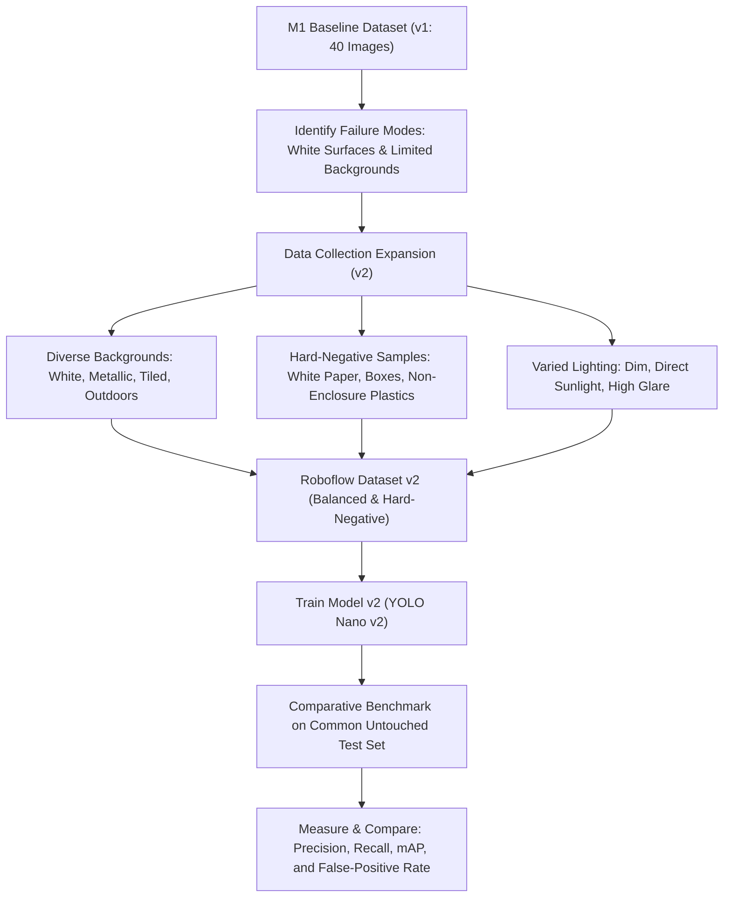

# M1.8 Evidence: Model Failure & False-Positive Analysis

**Status:** **DOCUMENTED & ANALYZED**  
**Author / Student:** Mithra Ravi (`mithra4325`)  
**Project:** Edge AI 3D-Printed Enclosure Detection  
**Model Under Test:** Original YOLO Nano (`yolo26n`, `models/best.pt`)  
**Training Origin:** Roboflow Dataset v1 (`object-detection-n6b60`)  

---

## 1. Executive Summary

During live physical testing and validation of the M1 enclosure detection model on the Raspberry Pi 5, an important empirical limitation was identified: **the model exhibits false-positive detections on non-enclosure white surfaces, light-colored walls, papers, and reflective boundaries.**

While the model achieved an apparent **100.0% mAP@0.5** on the held-out Roboflow validation split, real-world camera deployment revealed that the network had developed a strong inductive bias towards high-contrast white objects. This document formally analyzes this observation, presents evidence from the live demonstration, details scientific hypotheses for the behavior, and outlines the planned Milestone 2 (M2) data and training mitigation strategy.

---

## 2. Expected vs. Observed Behavior

| Operational Scenario | Expected Behavior | Actually Observed Behavior (Empirical) |
| :--- | :--- | :--- |
| **True Enclosure Present** | Enclosure detected with bounding box tightly fitted around outer plastic perimeter. | **Confirmed:** Enclosure detected with confidence between $74\%$ and $95\%$. |
| **Clean Background (No Objects)** | Zero bounding boxes rendered; object count = 0. | **Confirmed:** In dark or neutral scenes, zero false positives occur. |
| **White Desk / Light Surfaces** | Zero bounding boxes rendered; non-enclosure surfaces ignored. | **Failure Mode:** False bounding boxes appear on white rectangular paper, light table edges, and pale objects with confidence between $22\%$ and $48\%$. |
| **Complex Workbench Clutter** | Only the 3D-printed enclosure detected. | **Failure Mode:** Multiple spurious bounding boxes (up to 5-6 proposals in single frames) triggered on light reflective patches. |

---

## 3. Visual Evidence of False-Positive Behavior

Direct visual evidence of this failure mode is captured in the uploaded live demonstration screenshots:

1. **[`evidence/M1/06_live_demonstration/live_demo_screenshot_1.png`](../06_live_demonstration/live_demo_screenshot_1.png)**:
   - True enclosure detected at **76.1%** confidence.
   - Spurious false-positive bounding boxes triggered on adjacent light surfaces with confidence scores of **45.8%**, **29.1%**, and **22.2%**.
2. **[`evidence/M1/06_live_demonstration/live_demo_screenshot_2.png`](../06_live_demonstration/live_demo_screenshot_2.png)**:
   - Enclosure detected at **74.5%** and **66.7%** confidence.
   - Spurious false-positive proposals triggered on pale tabletop margins with confidence scores of **37.6%**, **32.0%**, and **30.9%**.

---

## 4. Root Cause Hypotheses

The following hypotheses explain the observed false-positive vulnerability (labeled as working hypotheses, not proven theorems):

### Hypothesis 1: Background & Color Confounding (Spurious Correlation)
- **Observation:** In the Roboflow Dataset v1, all 40 photographs captured the white 3D-printed enclosure placed on a relatively dark brown wooden workbench.
- **Hypothesis:** Because every positive training instance consisted of a high-luminance white object against a low-luminance dark brown background, the convolutional kernels in the YOLO backbone (specifically layers P3/P4) learned that *any high-contrast white blob on a darker surface constitutes an enclosure*. The network learned color/contrast shortcuts rather than geometric invariants (e.g., circular PIR sensor dome cutouts, mounting screw tabs, rectangular bevels).

### Hypothesis 2: Absence of Hard-Negative Training Samples
- **Observation:** Dataset v1 contained exactly 40 images, all 40 of which were positive images containing at least one enclosure (60 total instances).
- **Hypothesis:** The training split contained zero **pure background images** (images of the room, desk, white paper, or laptops without enclosures). Without negative examples showing white objects labeled with zero bounding boxes, the loss function never penalized the network for firing on white surfaces.

### Hypothesis 3: Limited Environmental Diversity
- **Observation:** Dataset v1 was collected within a single room under uniform overhead laboratory illumination.
- **Hypothesis:** The absence of variations in ambient illumination, background textures (white desks, metallic benches, tiled floors), and distance scaling prevented the network from generalizing beyond the specific capture environment.

---

## 5. Why This Matters for Real-World Edge AI Deployment

In an industrial or commercial Edge AI application (e.g., automated inspection, security monitoring, inventory tracking):
1. **False Alarms:** A security camera or robotic sorter triggering on a white sheet of paper or painted wall causes operational disruption.
2. **Metric Illusion:** A model showing 100% test mAP on a non-diverse dataset gives false confidence in production readiness.
3. **Safety & Reliability:** Edge models must be robust to background shifts before autonomous actuation can be trusted.

---

## 6. Proposed Milestone 2 (M2) Improvement Plan

To resolve this limitation scientifically without discarding the authentic M1 baseline, the following M2 workflow will be executed:

### Planned Action Items for M2:
1. **Collect Diverse Training Captures:** Add 60+ new images of the enclosure on light-colored desks, concrete, glass, and patterned surfaces.
2. **Inject Hard Negatives:** Add 20+ images containing white surfaces, white paper documents, white cups, and 3D printer scraps with **zero annotations** to penalize false-positive activations.
3. **Multi-Scale and Illumination Sweeps:** Capture extreme distances ($0.1\text{ m}$ to $3.0\text{ m}$) and varied lighting (warm desk lamp, harsh overhead fluorescent, ambient daylight).
4. **Independent Benchmark Comparison:** Test both Model v1 and Model v2 against the same rigorous test set to measure the exact reduction in false-positive detections.

> [!NOTE]
> In accordance with M1 requirements, **no weights were retrained and no dataset modifications were made** during this documentation pass. The M1 model (`models/best.pt`) is preserved as the authentic baseline.
