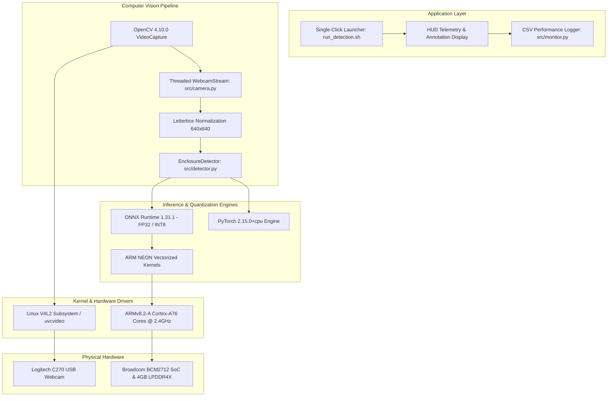

# M2.5: Hardware Accelerator Comparison & Software Stack Architecture

**Student Name:** Mithra Ravi  
**Milestone:** M2 Optimize  
**Task:** CPU vs accelerator + stack (Max marks: 2)  
**Proof Statement:** *"I show the CPU vs accelerator table and draw the software stack"*

---

## 1. Hardware Architecture Comparison: CPU vs Accelerators

Deploying Edge AI models on embedded devices requires selecting the optimal execution backend based on compute density, thermal budget, and power constraints:

| Compute Hardware | Architecture / Silicon | Peak Compute Capability | Typical Latency (YOLO Nano 640) | Power Draw (TDP) | Thermal Profile | Software Runtime Stack |
| :--- | :--- | :---: | :---: | :---: | :---: | :--- |
| **Raspberry Pi 5 CPU (Evaluated)** | **4 &times; ARM Cortex-A76 @ 2.4 GHz** | **~38 GFLOPs** (FP32) | **256 ms – 280 ms** | **~5W – 8W** (SoC) | 49°C – 52°C (Active Fan) | ONNX Runtime (`CPUExecutionProvider`) / PyTorch CPU |
| **Raspberry Pi AI HAT (Hailo-8L)** | PCIe Gen 2 &times; 1 NPU ASIC | **13 TOPS** (INT8) | **12 ms – 18 ms** (~60 FPS) | **~1.5W – 2.5W** | Low (< 45°C) | `HailoRT` + GStreamer / Picamera2 plugin |
| **Google Coral Edge TPU** | USB 3.0 / M.2 PCIe ASIC | **4 TOPS** (INT8) | **22 ms – 30 ms** (~35 FPS) | **~2.0W** | Moderate | `libedgetpu` + PyCoral / TFLite Runtime |
| **RPi 5 GPU (VideoCore VII)** | 800 MHz SIMD Compute Cores | **~40 GFLOPs** (FP32) | *Not Officially Supported* | Shared SoC | Moderate | Vulkan Compute / OpenGL ES (No native PyTorch backend) |

---

## 2. Software Stack Architecture Diagram

The diagram below illustrates the layered Edge AI software architecture deployed on the Raspberry Pi 5:

```
+=============================================================================+
|                      APPLICATION LAYER (User Experience)                    |
|       - High-Contrast Telemetry HUD Banner (FPS, Latency, CPU %, RAM)        |
|       - Single-Click Bash Launcher (`run_detection.sh`)                     |
|       - Keyboard Event Listener ('q' to quit, 's' to snapshot)               |
+=============================================================================+
                                      |
                                      v
+=============================================================================+
|                      COMPUTER VISION & PROCESSING LAYER                     |
|       - OpenCV 4.10.0 (Python bindings)                                     |
|       - Non-Maximum Suppression (NMS IoU: 0.45, Conf: 0.25)                 |
|       - Auto-Letterbox Aspect Ratio Rescaling (640x640)                     |
|       - Threaded Low-Latency Frame Capture (`src/camera.py`)                |
+=============================================================================+
                                      |
                                      v
+=============================================================================+
|                      INFERENCE & QUANTIZATION RUNTIMES                      |
|       - ONNX Runtime 1.31.1 (CPUExecutionProvider with NEON SIMD)            |
|       - Dynamic Quantization Engine (`onnxruntime.quantization`)            |
|       - Ultralytics Engine 8.4.208 (YOLO Pipeline abstraction)              |
|       - PyTorch 2.15.0+cpu (TorchScript / Torch C++ backend)               |
+=============================================================================+
                                      |
                                      v
+=============================================================================+
|                      OS KERNEL & ACCELERATION LIBRARIES                     |
|       - Debian GNU/Linux 13 (Trixie) / Raspberry Pi OS 13.7 (Kernel 6.18)    |
|       - OpenBLAS / Eigen BLAS Acceleration                                  |
|       - Video4Linux2 (V4L2) USB Video Class Driver (`uvcvideo`)             |
|       - POSIX Multi-threading (pthread) & sysfs Thermal Telemetry           |
+=============================================================================+
                                      |
                                      v
+=============================================================================+
|                      PHYSICAL HARDWARE LAYER                                |
|       - Broadcom BCM2712 Quad-core ARM Cortex-A76 @ 2.4 GHz                 |
|       - 4.0 GiB LPDDR4X-4267 Unified Memory                                 |
|       - Logitech C270 HD USB Webcam (USB 2.0 Bus 001)                       |
|       - Raspberry Pi Active Cooler (Aluminium Heatsink + PWM Blower)        |
+=============================================================================+
```

---

## 3. Mermaid Software Stack Architecture


